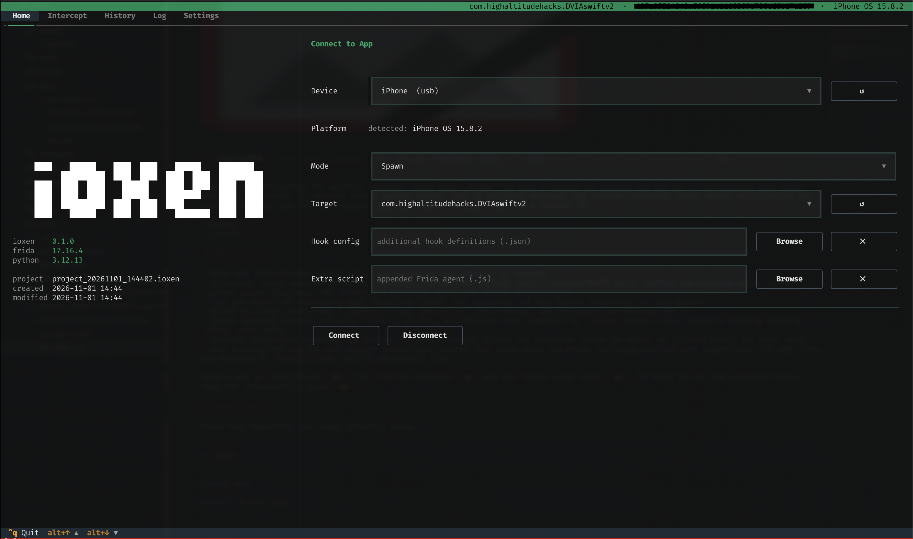
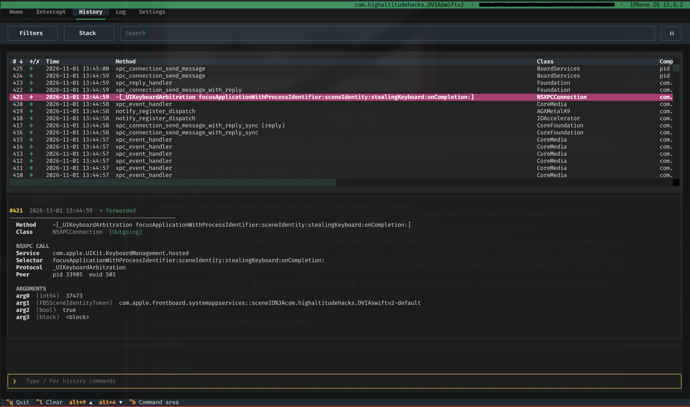

> **Disclaimer #1**: This tool is based on the amazing _Francesco Volpe_'s [Noxen](https://github.com/frankheat/noxen) tool.  
> **Disclaimer #2**: Tool developed using AI... 


iOS runtime interception for security research. ioxen uses **Frida** to hook a running iOS process and map how it communicates with other processes at runtime. It captures attack surface events, such as XPC/NSXPC messages, URL schemes, universal links, Darwin notifications and network activity, and lets you inspect, modify, forward, or drop them from a terminal UI. 


## What It Does

- Helps map inter-process communication and attack surface behavior at runtime.
- Intercepts libxpc messages (outgoing, incoming, replies, new listener peers), decoded NSXPC calls, replies and exported-object calls, listener accept decisions, URL schemes and universal links, and Darwin notifications.
- Lets you modify XPC dictionary keys, Objective-C/NSXPC call arguments and URLs before forwarding, or drop events.
- Builds an attack surface map (`/surface`) from `Info.plist`, entitlements, app extensions and observed IPC.
- Stores captured history, outcomes, filters, columns, and modified event snapshots in `.ioxen` project files (projects saved by noxen as `.noxen` still open).
- Provides independent Intercept and History filters; intercept filters are evaluated inside the agent, so filtered events are never held.
- Uses a structured Log tab with aligned source/level columns that shows every log entry, including detailed hook diagnostics, the same lines are mirrored to `<project>.log` next to the project file.

Details are in [docs/ios.md](docs/ios.md).

## Quick Start

Clone this repository and change directory there.

```bash
cd ioxen
```

Create venv:
```bash
python3 -m venv venv
```


```bash
source venv/bin/activate
```

Install the Frida Python package that matches the `frida-server` version you run on the (jailbroken) iOS device. For example:

```bash
venv/bin/pip install frida==17.16.4
```

Then, from the repository root, install ioxen:

```bash
venv/bin/pip install .
```

Launch ioxen:

```bash
ioxen
```

Select the device, mode, and target app from the Home tab. The detected OS is shown next to the device; ioxen warns in the Log tab if the target is not an Apple process. Use `ioxen --project session.ioxen` to open an existing project or `ioxen --new-project session` to create one.

Use an editable install only when developing ioxen itself:

```bash
pip install -e .
```

## What it looks like






## Credits

- [Francesco Volpe](https://github.com/frankheat)

## License

ioxen is released under the [GNU General Public License v3.0](LICENSE).
